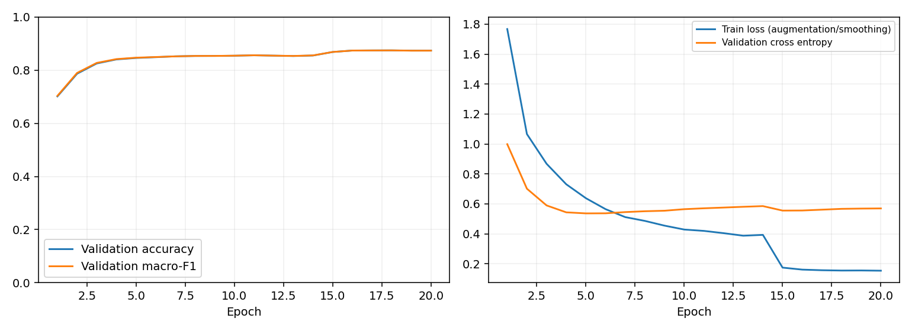

# Document Image Classification

Tugas 2 Supervised Machine Learning — Constantine Calvin Gosal Jo, 5052241010.
Klasifikasi 16 jenis dokumen menggunakan **PyTorch**, **ConvNeXt Tiny**, dan
**EfficientNetV2-S**. Kedua model di-fine-tune dari bobot ImageNet-1K torchvision.

**Submission terbaru: geometric mean 50:50 — skor Kaggle dilaporkan 0,88582**
(pembaruan 28 Oktober 2026). Unduh
[submission_geometric_088582.csv](submissions/submission_geometric_088582.csv).
Akurasi validasi lokalnya **0,885325 (5.659/6.392)**. Skor Kaggle berasal dari
laporan pemilik repository; jenis leaderboard dan peringkat belum diberikan.

Baseline arithmetic mean 50:50 tetap tersedia dengan validation accuracy
**0,884230** dan skor Kaggle yang dilaporkan **0,88456**. Kenaikan skor Kaggle
adalah **0,00126 atau 0,126 poin persentase**. Ini pembaruan pooling probabilitas
CNN yang sudah dilatih, bukan hasil training ulang backbone. Target 0,90 belum
tercapai. Lihat [riwayat CSV](submissions/README.md),
[manifest identitas](submissions/manifest.json), dan
[pipeline lengkap beserta diagram](docs/PIPELINE_FLOW.md).

| Versi | Validation accuracy | Skor Kaggle dilaporkan | Status |
|---|---:|---:|---|
| Arithmetic mean 50:50 | 0,884230 | 0,88456 | Baseline dipertahankan |
| **Geometric mean 50:50** | **0,885325** | **0,88582** | Submission terbaru |

## Notebook utama dan bukti hasil

| Berkas | Kegunaan |
|---|---|
| [Document_Classification_v2_2_Kaggle.ipynb](notebooks/Document_Classification_v2_2_Kaggle.ipynb) | Notebook mandiri untuk run baru; seluruh source disertakan dan patch GPU terintegrasi |
| [v2_gpu_fix_kaggle.ipynb](notebooks/executed/v2_gpu_fix_kaggle.ipynb) | Notebook asli yang sudah dieksekusi: audit, 20 epoch per model, evaluasi dan ensemble |
| [results/v2_gpu_fix](results/v2_gpu_fix) | History lengkap, metrik, laporan per kelas, kurva dan confusion matrix dari output notebook asli |
| [evidence_manifest.json](results/v2_gpu_fix/evidence_manifest.json) | Sumber bukti, hash notebook asli, epoch terpilih dan batasan data yang tersedia |
| [results/refinement_20261027](results/refinement_20261027) | Hasil tiga putaran iterasi probabilitas, pemeriksaan independen, dan pembaruan skor Kaggle |
| [PIPELINE_FLOW.md](docs/PIPELINE_FLOW.md) | Diagram dari audit sampai submission serta cara reproduksi CSV terbaru |

Arsip eksekusi dipertahankan utuh. Metadata lama di dalam arsip masih menulis
`competition_training_executed: false`, tetapi output sel memperlihatkan training
dan evaluasi selesai. Penilaian hasil mengikuti log eksekusi dan metrik tersebut.
Source v2.2 menambahkan dokumentasi, diagnostik GPU, ekspor hasil dan pemeriksaan
konsistensi. Pembaruan notebook menambahkan tahap 6b untuk menghasilkan CSV
geometric terpisah; notebook eksekusi historis tetap utuh. **Output historis tidak disalin sebagai output hasil run v2.2.**

## Hasil training baseline yang tercatat

Split: **25.567 train / 6.392 validasi**, seed 42. Perbandingan ditampilkan sesuai
presisi enam desimal pada notebook; metrik model tunggal dengan presisi penuh
tersedia pada `metrics.json` masing-masing model.

| Kandidat | Validation accuracy | Macro-F1 | Log-loss |
|---|---:|---:|---:|
| **ensemble_equal** | **0.884230** | **0.884022** | **0.487083** |
| convnext_tiny | 0.874374 | 0.874207 | 0.566750 |
| efficientnet_v2_s | 0.873123 | 0.872812 | 0.597911 |

Ensemble meningkatkan akurasi sekitar **0,986 poin persentase** terhadap ConvNeXt
dan **1,111 poin persentase** terhadap EfficientNet. Probabilitas kelas dirata-rata
dengan bobot tetap, lalu kelas probabilitas terbesar menjadi prediksi. Ini memberi
bukti manfaat ensemble pada holdout tersebut, tetapi belum membuktikan kestabilan
antarseed atau mengukur signifikansi statistik peningkatannya.

Checkpoint EMA terbaik: **epoch 18 untuk ConvNeXt** dan **epoch 16 untuk
EfficientNet**. Keduanya menjalankan 20 epoch. Resolusi inferensi yang terpilih
adalah **384 saja** pada kedua model. Kandidat rata-rata 384+448 dibandingkan
melalui validasi, tetapi bukan kebijakan yang terpilih pada run ini.

### Interpretasi kesalahan dan overfitting

- `scientific_report` paling sulit pada kedua model: F1 sekitar 0,7124 dan
  0,7132. `form` sekitar 0,755 dan `presentation` sekitar 0,783/0,766 juga
  membutuhkan perhatian. Kemiripan struktur halaman menjadi hipotesis yang
  masuk akal, tetapi perlu pemeriksaan contoh kesalahan untuk mengonfirmasinya.
- `email` relatif mudah: F1 sekitar 0,9765 dan 0,9813. Karena support validasi
  per kelas berada sekitar 389–411, hasil keseluruhan tidak didominasi satu
  kelas yang sangat besar.
- Setelah epoch terbaik, validation loss meningkat. Pada EfficientNet,
  accuracy epoch 20 turun menjadi sekitar 0,870776 dan log-loss naik menjadi
  0,636940, dibanding 0,873123 dan 0,597911 pada epoch 16. Ini konsisten dengan
  memburuknya generalisasi/kalibrasi pada akhir training, sehingga `best.pt`
  lebih tepat dipakai daripada bobot epoch terakhir.
- `train_soft_accuracy` memakai augmentasi, label smoothing/mixup dan bobot
  training, sedangkan validasi memakai EMA. Angkanya tidak dapat diperlakukan
  sebagai clean train–validation gap. File diagnostik clean-train tidak
  dicetak pada arsip notebook awal. Arsip review yang kemudian tersedia memuat
  evaluasi sampel clean-train 2.048 gambar: ConvNeXt 1,000 dan EfficientNet
  0,999023. Bukti tambahan dan keterbatasannya dicatat di
  [laporan refinement](results/refinement_20261027/HASIL_ITERASI_RVL_CDIP.md).
- Epoch, resolusi, dan kandidat akhir dipilih memakai holdout yang sama.
  Accuracy tersebut adalah **skor seleksi**, bukan estimasi test independen.




Confusion matrix: [ConvNeXt](results/v2_gpu_fix/convnext_tiny/confusion_matrix.png)
dan [EfficientNet](results/v2_gpu_fix/efficientnet_v2_s/confusion_matrix.png).

## Dataset dan audit

Unduh data dari [kompetisi Kaggle Document Image Classification](https://www.kaggle.com/competitions/document-image-classification-sd234504/data).
Jika kompetisi belum terlihat, gunakan [tautan undangan kelas](https://www.kaggle.com/t/ec93bc56cc9842959bb6728723d23d29)
dan setujui aturan kompetisi dengan akun sendiri. Tambahkan dataset melalui
**Add Input** di Kaggle. Repository tidak menyertakan dataset atau checkpoint.

Berkas yang diperlukan: `train.csv`, `test.csv`, `sample_submission.csv`, serta
gambar di direktori `train/` dan `test/` atau ZIP-nya. Metadata path dapat berupa
`filename` atau `image_path`; submission mengikuti ID dan urutan template asli.

| Temuan pada run historis | Jumlah |
|---|---:|
| Baris training sebelum audit | 32.003 |
| Baris test | 7.994 |
| Gambar training rusak yang dikeluarkan | 1 |
| Baris duplikat dengan label konflik yang dikeluarkan | 43 |
| Baris training bersih | 31.959 |
| Baris duplikat training tersisa menurut laporan audit | 8 |
| Kelompok piksel identik antara train dan test | 6 |

Pengeluaran dilakukan melalui metadata; gambar sumber tidak dihapus. Piksel
identik ditempatkan pada sisi split yang sama untuk mencegah exact-duplicate
leakage. Overlap train/test hanya dilaporkan; label training tidak disalin ke
test. Nama folder atau ID tidak menjadi fitur model. Audit hash persis masih
dapat melewatkan near-duplicate dan halaman berbeda dari sumber dokumen sama.

Gambar yang sudah tersedia dibaca langsung. ZIP dapat dibaca tanpa ekstraksi;
tidak perlu mengimpor gambar satu per satu. Audit pertama mendekode gambar dan
menyimpan cache SQLite, sedangkan audit berikutnya menggunakan cache untuk
berkas yang tidak berubah. Training tetap memerlukan pembacaan minibatch.

## Menjalankan di Kaggle

1. Import [notebook v2.2](notebooks/Document_Classification_v2_2_Kaggle.ipynb),
   tambahkan dataset kompetisi, aktifkan GPU dan Internet untuk bobot ImageNet.
2. Biarkan `DATA_ROOT=None` bila hanya ada satu dataset gambar yang sesuai,
   atau isi path folder CSV. Tambahkan `IMAGE_ROOTS` jika gambar berada terpisah.
3. Jalankan sel secara berurutan. Notebook membuat source, memeriksa runtime,
   mengaudit data, membuat split, melatih model, mengevaluasi dan membuat CSV.
4. Gunakan `RUN_TAG` baru untuk perubahan hyperparameter/source. Default v2.2
   terpisah dari run historis `v2_gpu_fix`.
5. Unduh `submission_geometric.csv` dari tahap 6b untuk pooling terbaru.
   `submission.csv` dan `submission_manifest.json` tetap memuat pilihan dari
   perbandingan baseline. Unduh juga `github_results.zip`.
   Arsip terakhir berisi README dan hasil agregat untuk memperbarui GitHub.
6. **Save Version** dengan output sebelum sesi berakhir. `best.pt` dan `last.pt`
   ada di `outputs/<run_name>/`; keduanya tidak dimasukkan ke GitHub.

Jika sesi lama sudah berakhir, pasang output tersimpan sebagai Input lalu salin
folder run yang diperlukan ke `PROJECT/outputs`. `ENABLE_TRAINING=False`
memerlukan `best.pt` yang benar-benar tersedia; flag tersebut tidak memulihkan
checkpoint yang hilang. Resume training membutuhkan `last.pt`, konfigurasi,
fingerprint split dan hash source yang cocok. Run dengan source berbeda harus
memakai tag baru; jangan menonaktifkan pemeriksaan fingerprint.

## Menjalankan melalui terminal

Gunakan Python 3.12+ dan pasangan torch/torchvision yang kompatibel dengan GPU.
Di Kaggle gunakan paket bawaan; jangan mengganti versi secara sembarangan.
Contoh setup CPU untuk menguji kode (bukan training kompetisi):

```bash
git clone https://github.com/Constantine1507/Document-Image-Classification.git
cd Document-Image-Classification
python -m venv .venv
# Linux/macOS: source .venv/bin/activate
# Windows PowerShell: .venv\Scripts\Activate.ps1
python -m pip install --index-url https://download.pytorch.org/whl/cpu torch==2.8.0 torchvision==0.23.0
python -m pip install -r requirements-dev.txt
python scripts/validate_repository.py
python tests/runtime_test.py
python tests/smoke_test.py
python tests/notebook_smoke.py
```

Training penuh membutuhkan GPU. Jalankan dari akar repository:

```bash
python scripts/run.py diagnose
python scripts/run.py prepare --data-root /path/to/document-data
python scripts/run.py train --config configs/convnext_tiny.json --run-name convnext_tiny_v2_2_seed42
python scripts/run.py train --config configs/efficientnet_v2_s.json --run-name efficientnet_v2_s_v2_2_seed42
python scripts/run.py evaluate --run-dir outputs/convnext_tiny_v2_2_seed42
python scripts/run.py evaluate --run-dir outputs/efficientnet_v2_s_v2_2_seed42
python scripts/run.py compare --evaluation-dir outputs/convnext_tiny_v2_2_seed42/evaluation --evaluation-dir outputs/efficientnet_v2_s_v2_2_seed42/evaluation
python scripts/run.py report --evaluation-dir outputs/convnext_tiny_v2_2_seed42/evaluation --evaluation-dir outputs/efficientnet_v2_s_v2_2_seed42/evaluation
python scripts/run.py export
```

Konfigurasi: 20 epoch, resolusi train 320 lalu 384 mulai epoch 15, batch 8
dengan akumulasi 4, AdamW, warmup/cosine, EMA, label smoothing dan mixup ringan.
Learning rate backbone ConvNeXt 1e-4, EfficientNet 2e-4, classifier 5 kali lebih
besar. [Metodologi lengkap](docs/METHODOLOGY.md) menjelaskan alasan dan batasannya.

## Struktur repository

| Direktori/berkas | Isi |
|---|---|
| `src/docvision_v2/` | Data, model, training, evaluasi, runtime, ekspor laporan |
| `src/docvision_calibration/` | Pooling geometric, kalibrasi neural dan nested group CV |
| `configs/refinement/` | Rencana tiga putaran eksperimen yang sudah dijalankan |
| `submissions/` | CSV baseline dan terbaru, hash serta riwayat skor |
| `results/refinement_20261027/` | Bukti iterasi dan catatan skor yang dilaporkan 28 Oktober |
| `configs/` | Konfigurasi kedua arsitektur |
| `scripts/` | CLI, pembangun notebook, ekstraksi bukti dan validator |
| `notebooks/` | Notebook run baru dan arsip eksekusi asli |
| `results/v2_gpu_fix/` | Bukti eksperimen historis |
| `results/latest/` | Hasil yang dibuat setelah run baru; tidak dicampur dengan hasil historis |
| `validation/` | Hasil pengujian lokal menggunakan data sintetis |
| `tests/` | Pengujian data, resume, AMP, backbone dan eksekusi notebook |
| `.github/workflows/validate.yml` | Pemeriksaan CPU otomatis pada push/PR |
| `docs/` | Metodologi, kesesuaian tugas dan pemecahan masalah |

`data/`, `checkpoint/`, `checkpoints/`, `outputs/`, dataset, bobot dan kredensial
diabaikan oleh `.gitignore`. Setiap function/class Python memiliki docstring.

## Reproduksibilitas dan batas bukti

Notebook arsip membuktikan run GPU yang tercatat. Source pemeliharaan v2.2
diverifikasi pada data sintetis dan CPU: termasuk forward/backward kedua
arsitektur, resume setara uninterrupted run, gradient accumulation dengan
batch terakhir pendek, TIFF/ZIP, ID submission dan ensemble. Pengujian CPU
tidak menggantikan pengujian training penuh di Kaggle.

**CSV baseline dan submission terbaru kini disertakan di `submissions/`.**
Hash dan seluruh ID telah diperiksa. Bobot checkpoint dan probabilitas lengkap
masih disediakan di luar Git. Reproduksi CSV terbaru secara persis menggunakan
arsip `docvision_v2_review.zip` asli, tanpa memerlukan gambar 4 GB atau training
ulang. [Panduan reproduksi](docs/PIPELINE_FLOW.md) membedakan jalur arsip asli
tersebut dari inferensi hasil run baru. Menjalankan training baru menghasilkan
run baru; hasil CUDA tidak dijanjikan identik bit demi bit antarmesin/versi.

```bash
python scripts/verify_submissions.py
python -m pip install -r requirements-refinement.txt
python scripts/finalize_submission.py --review-zip /path/to/docvision_v2_review.zip --output outputs/reproduced_final
```

Dua putaran korektor terlatih tidak memperbaiki nested CV secara stabil.
Geometric mean tetap dipilih setelah perbandingan eksploratif; hasil akhir
memperbaiki 27 kesalahan validasi sekaligus merusak 20 prediksi benar, bersih +7.
Seluruh label test berasal dari inferensi; 97 label berbeda dari baseline.
Skor 0,88582 dicatat pada file yang hash-nya dikenal, bukan dipasang otomatis
pada setiap hasil reproduksi/training baru.

Ekstraksi bukti dapat diulang dengan `python scripts/extract_run_evidence.py`.
Notebook dapat dibangun ulang dengan `python scripts/build_notebook.py`;
`--check` memverifikasi sinkronisasi tanpa menulis ulang. Hasil baru diekspor ke
`results/latest`, sedangkan bukti historis tetap berada di `results/v2_gpu_fix`.

Lihat [pemetaan ketentuan tugas](docs/ASSIGNMENT_COMPLIANCE.md) dan
[pemecahan masalah](docs/TROUBLESHOOTING.md). Skor Kaggle dan nilai tugas tidak
dijanjikan meningkat hanya karena source/documentasi diperbarui.

<!-- LATEST_RUN_START -->
Belum ada hasil training kompetisi baru dari source v2.2 yang dicatat pada bagian ini.
<!-- LATEST_RUN_END -->
