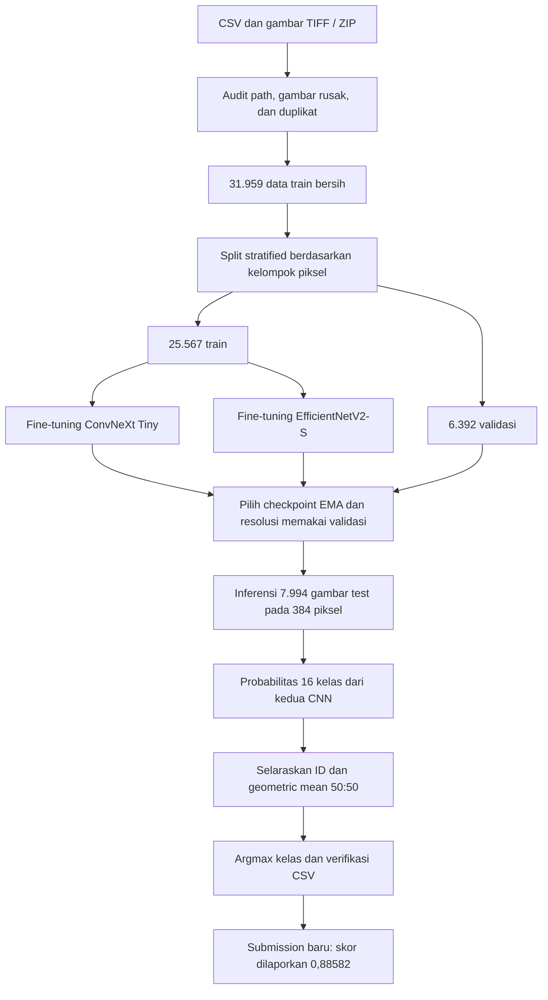

# Pipeline klasifikasi dokumen dan pembaruan geometric mean

Pembaruan 28 Oktober 2026 menambahkan submission geometric mean 50:50.
**Skor Kaggle yang dilaporkan pemilik repository: 0,88582.** Akurasi validasi
lokal: **0,885325 (5.659/6.392)**. Skor tersebut berasal dari dua evaluasi berbeda.
Skor Kaggle tidak diisi otomatis oleh kode, dan jenis leaderboard belum diketahui.

## Alur dari data ke submission



## Tahapan dan implementasi

| Tahap | Yang dilakukan | Source |
|---|---|---|
| Akses data | Membaca CSV dan gambar dari file/ZIP, tanpa menyalin gambar satu per satu | `src/docvision_v2/data.py` |
| Audit | Memeriksa decode TIFF, path, hash piksel, duplikat dan konflik label | `src/docvision_v2/data.py` |
| Split | Seed 42, sekitar 80:20; piksel identik tetap pada sisi yang sama | `stratified_group_holdout()` |
| Preprocessing | Konversi RGB, letterbox dengan padding putih, normalisasi ImageNet | `src/docvision_v2/models.py` |
| Augmentasi train | Affine ringan serta perubahan brightness/contrast; seluruh halaman dipertahankan | `make_transform()` |
| Fine-tuning | CNN berbobot awal ImageNet-1K, classifier 16 kelas, AdamW, warmup/cosine, AMP, akumulasi gradien, EMA | `src/docvision_v2/engine.py` |
| Evaluasi | Accuracy, macro-F1, log-loss, confusion matrix, kesalahan per kelas, pemilihan checkpoint/resolusi | `src/docvision_v2/evaluate.py` |
| Ensemble baru | Geometric mean dari probabilitas CNN yang sudah diselaraskan berdasarkan ID | `src/docvision_calibration/power.py` dan `submission.py` |
| Ekspor | Argmax 0–15, urutan template, hash dan metadata output | `scripts/ensemble_geometric.py` |
| Audit berkas | Verifikasi hash CSV yang dipublikasikan dan 97 perubahan label | `scripts/verify_submissions.py` |

Training historis memakai 20 epoch per model, resolusi 320 lalu 384 mulai epoch 15,
batch 8 dengan akumulasi 4, label smoothing serta mixup ringan sebelum tahap akhir.
Checkpoint terpilih: **ConvNeXt EMA epoch 18** dan **EfficientNet EMA epoch 16**.
Evaluasi 384+448 telah dibandingkan; hasil historis memilih **384 saja**.

Pembaruan ini memakai probabilitas dari checkpoint tersebut. **Tidak ada
training ulang backbone atau penambahan VLM** pada submission 0,88582 ini.
Seluruh prediksi berasal dari neural network PyTorch; tidak menggunakan
TensorFlow/JAX atau classifier non-neural.

## Perubahan terhadap baseline

Baseline mengambil rata-rata aritmetika probabilitas:

\[
p_{\mathrm{lama}}(c)=\frac{p_{\mathrm{ConvNeXt}}(c)+p_{\mathrm{EfficientNet}}(c)}{2}.
\]

Submission terbaru menggunakan rata-rata geometrik yang dinormalisasi:

\[
p_{\mathrm{baru}}(c)=
\frac{\sqrt{p_{\mathrm{ConvNeXt}}(c)p_{\mathrm{EfficientNet}}(c)}}
{\sum_k\sqrt{p_{\mathrm{ConvNeXt}}(k)p_{\mathrm{EfficientNet}}(k)}}.
\]

Implementasi menghitung `softmax(0.5 * log(p1) + 0.5 * log(p2))` dalam
`torch.nn.Module`, dengan probabilitas dijepit minimal `1e-12` untuk kestabilan
numerik. Prediksi akhir tetap `argmax`; tidak ada perataan angka label kelas.
Aturan ini memberi penalti lebih besar ketika salah satu CNN memberi probabilitas
sangat kecil kepada suatu kelas. Manfaatnya harus diperiksa melalui evaluasi.

| Ukuran | Baseline | Geometric 50:50 |
|---|---:|---:|
| Benar pada 6.392 validasi | 5.652 | 5.659 |
| Validation accuracy | 0,884230 | 0,885325 |
| Validation macro-F1 | 0,884022 | 0,885074 |
| Validation log-loss | 0,487083 | 0,483779 |
| Skor Kaggle dilaporkan pemilik | 0,88456 | **0,88582** |

Pada validasi, 27 kesalahan diperbaiki dan 20 prediksi benar menjadi salah:
tambahan bersih 7. Pada test, 97 label berubah. Interval bootstrap deskriptif
kenaikan validasi mencakup nol. Kenaikan kecil ini tidak membuktikan performa
private leaderboard, kestabilan antarseed, atau keberhasilan melewati 0,90.

## Reproduksi dari evaluasi CNN baru

Jalankan training dan evaluasi v2 seperti panduan README. Kemudian tambahkan
langkah berikut dari akar repository:

```bash
python scripts/ensemble_geometric.py \
  --convnext outputs/convnext_tiny_v2_2_seed42/evaluation/test.npz \
  --efficientnet outputs/efficientnet_v2_s_v2_2_seed42/evaluation/test.npz \
  --sample-submission /path/to/document-data/sample_submission.csv \
  --output outputs/geometric_new_run/submission.csv
```

Setiap NPZ harus memuat `ids` unik dan `probabilities` berukuran N × 16 dengan
urutan kelas 0–15. Skrip menolak ID hilang/berulang atau probabilitas tidak valid,
menyelaraskan kedua model ke urutan template, dan menghasilkan CSV serta manifest.
Nilai label placeholder pada template tidak digunakan sebagai fitur atau target.

Notebook mandiri v2.2 juga menambahkan tahap **6b** dan mengekspor
`submission_geometric.csv` sebagai file terpisah. Output baseline dari tahap
perbandingan model tetap tersedia. Run training baru menghasilkan prediksi baru;
skor 0,88582 tidak boleh otomatis ditempelkan pada output tersebut.

## Reproduksi persis dari arsip review asli

Untuk membuat ulang CSV yang dipublikasikan tanpa training/gambar 4 GB, gunakan
`docvision_v2_review.zip` asli. Arsip probabilitas ini disediakan terpisah dan
tidak ditambahkan ke Git. SHA-256:

`5413541af29b368114a0912e1e7bac7cdf04ff9bf85153c5812e3dbd50c68222`

```bash
python -m pip install -r requirements-refinement.txt
python scripts/finalize_submission.py --review-zip /path/to/docvision_v2_review.zip --output outputs/reproduced_final
python scripts/verify_refinement.py --review-zip /path/to/docvision_v2_review.zip --final-dir outputs/reproduced_final --report-dir outputs/reproduced_checks
```

Hasil `outputs/reproduced_final/submission.csv` cocok dengan
`submissions/submission_geometric_088582.csv`, SHA-256:

`812d1b43a69b2cfc5875f8930a38db54b6e33c2db259dc4252a873882d35afa1`

Skrip juga membuat alternatif harmonic mean untuk mereproduksi hasil eksplorasi.
Alternatif tersebut bukan submission yang diberi skor 0,88582 pada pembaruan ini.
Manifest hasil eksekusi menyimpan metrik lokal; catatan skor Kaggle terpisah di
[`kaggle_score_reported.json`](../results/refinement_20261027/kaggle_score_reported.json).

## Eksperimen yang mendasari pilihan

| Putaran | Metode | Hasil penilaian lapisan koreksi |
|---|---|---:|
| 1 | 15 konfigurasi: temperature, bias, residual linear/MLP, ensemble | 0,882979 nested group CV |
| 2 | 10 konfigurasi berfokus pada contoh ambigu dan pemilih neural | 0,883605 nested group CV |
| 3 | 85 kombinasi bobot dan eksponen pooling | 0,885169 cross-fit |
| Aturan akhir | Geometric mean tetap 50:50 | 0,885325 pada holdout |

Kedua prosedur nested tidak melewati gate promosi. Pilihan geometric mean tetap
diambil setelah membandingkan hasil eksplorasi; bukan keluaran gate yang lulus.
Checkpoint CNN dan rancangan eksperimen telah memakai holdout yang sama,
sehingga hasil ini bukan estimasi independen seluruh pipeline.

```bash
python scripts/refine_probabilities.py --review-zip /path/to/docvision_v2_review.zip --plan configs/refinement/experiment_plan.json --output outputs/refinement_round1
python scripts/refine_probabilities.py --review-zip /path/to/docvision_v2_review.zip --plan configs/refinement/targeted_plan.json --output outputs/refinement_round2
python scripts/search_pooling.py --review-zip /path/to/docvision_v2_review.zip --output outputs/refinement_power
```

Gunakan direktori output baru; source/config/data yang berubah menolak resume
agar hasil tidak tercampur. Source snapshot historis kedua putaran disimpan
bersama ringkasannya. Hasil asli tanggal 27 Oktober mencatat skor Kaggle belum
tersedia pada waktu itu; pembaruan tanggal 28 Oktober disimpan sebagai catatan
terpisah, tanpa mengubah hasil validasi historis.

Audit hash hanya menangani duplikat persis. Tidak ada lookup jawaban berdasarkan
ID/nama file, kuota kelas test, atau penggunaan label test dalam fitting.
