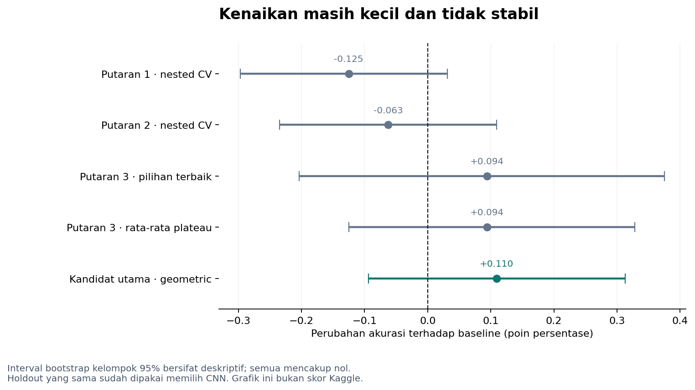

# Bukti iterasi probabilitas

Eksperimen dijalankan pada **27 Oktober 2026**. Pembaruan skor Kaggle diterima
pada **28 Oktober 2026**: **0,88582**, dilaporkan pemilik repository untuk
submission utama geometric mean 50:50. Lihat
[kaggle_score_reported.json](kaggle_score_reported.json) dan
[CSV terbaru](../../submissions/submission_geometric_088582.csv).

File `summary.json`, `selection_manifest.json`, serta laporan eksperimen asli
merekam keadaan saat eksperimen: skor Kaggle baru belum tersedia. Nilai `null`
di file historis tersebut dipertahankan; pembaruan skor dicatat terpisah.

| Lokasi | Isi |
|---|---|
| `round1/` | 15 konfigurasi, nested group CV; gate promosi gagal |
| `round2/` | 10 konfigurasi berfokus pada contoh ambigu; gate promosi gagal |
| `power/` | 85 kombinasi pooling dan hasil cross-fit |
| `round*/source_snapshot/` | Source yang benar-benar digunakan pada masing-masing putaran |
| `HASIL_ITERASI_RVL_CDIP.md` | Analisis rinci pada saat eksperimen |
| `selection_manifest.json` | Formula, metrik validasi, hash dan provenance dua kandidat awal |
| `REPRODUCTION_CHECK.json` | Pemeriksaan NumPy independen terhadap probabilitas asli |
| `changed_test_predictions.csv` | 97 label test yang berubah dari baseline ke geometric mean |
| `per_class_final_comparison.csv` | Precision, recall, F1 dan support per kelas |

Nama file relatif dalam manifest historis merujuk pada direktori output
`scripts/finalize_submission.py`, bukan nama CSV versi publik di `submissions/`.
Kandidat harmonic mean masih eksploratif dan tidak menerima skor 0,88582 ini.
Input NPZ dan checkpoint tidak dimasukkan ke Git; prosedur reproduksi ada di
[PIPELINE_FLOW.md](../../docs/PIPELINE_FLOW.md).

Pemeriksaan tambahan saat integrasi GitHub disimpan di
[`validation/refinement_20261028`](../../validation/refinement_20261028).
